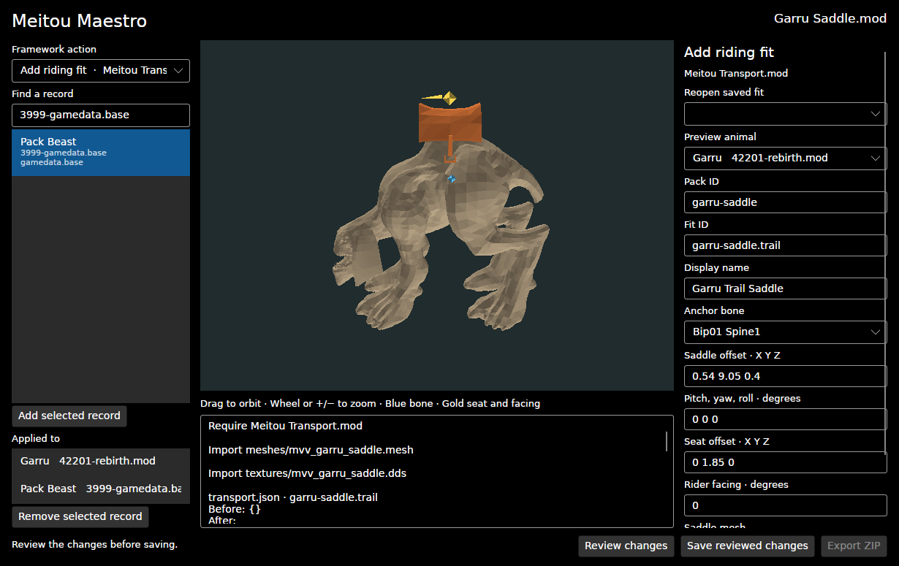

# Make a riding pack with Maestro

Maestro playtest.1 targets **MeitouClient v0.20.1** and **Meitou Transport playtest.5**. The author needs an installed copy of Kenshi. Each editor archive includes its own .NET runtime. Players install the resulting mod and its dependencies.

## Open the editor

1. Extract the editor for your system. On Windows, open **MeitouMaestro.exe**. On Linux, extract the `.tar.gz` with `tar -xzf` and run **./MeitouMaestro** from the extracted folder in your desktop session. Use a desktop with OpenGL. On minimal Ubuntu 24.04, install the X11, Mesa GL, fontconfig, ICU and GTK 3 desktop libraries. The tested Linux environment is Ubuntu 24.04 x64 under WSLg.
2. Extract the [Transport framework ZIP](https://github.com/Meitou-Modding-Ecosystem/MeitouTransport/releases/tag/v0.3.0-playtest.5) into Kenshi’s `mods` folder. The framework includes the `maestro.json` that supplies **Add riding fit**. Enable the framework in your authoring profile. To fit a custom animal from a separate mod, enable that mod too.
3. Choose your Kenshi installation, the extracted **game** directory containing the v0.20.1 `Meitou.Core.dll` and `Meitou.Data.dll`, and an empty writable project folder named **Garru Saddle**. You can paste paths into all three fields. [Meitou v0.20.1 game packages](https://github.com/VlcekM/MeitouClient/releases/tag/v0.20.1)

Extract the Garru Saddle example ZIP from the same Transport release into a reference folder. Its meshes and textures can be freely reused.

## Recreate the fit

Choose **Add riding fit**. Search for each FCS ID and use **Add selected record** for Garru (`42201-rebirth.mod`) and Pack Beast (`3999-gamedata.base`). Use the **Preview animal** list to inspect both and choose their shared **Bip01 Spine1** bone.

| Field | Reference value |
| --- | --- |
| Pack ID / Fit ID | `garru-saddle` / `garru-saddle.trail` |
| Display name | Garru Trail Saddle |
| Saddle offset | `0.54 9.05 0.4` |
| Pitch, yaw, roll | `0 0 0` |
| Seat offset / rider facing | `0 1.85 0` / `0` |
| Mesh / diffuse texture | `Garru Saddle/meshes/mvv_garru_saddle.mesh` / `Garru Saddle/textures/mvv_garru_saddle.dds` |

Drag the animal to orbit. Use the wheel to zoom, or click the view and use **+** and **−**. Blue marks the bone. Gold marks the pelvis and forward direction. The preview uses solid colours and the bind pose. The game renders the material and animation.

Choose **Review changes**, inspect the FCS dependency and JSON, then **Save reviewed changes**. To inspect it again, open the same project and choose **Reopen saved fit → garru-saddle.trail**. **Export ZIP** writes the saved project as a folder-wrapped archive. Pick a destination outside the mod folder.

For your own animal, substitute its FCS record, fit IDs, bone, offsets and art. Each animal sharing a fit must have the selected bone. Maestro adds the defining mod dependency when needed. You can author the pack without compiling C#.

## What the player receives



```text
Garru Saddle/
  Garru Saddle.mod
  transport.json
  meshes/mvv_garru_saddle.mesh
  textures/mvv_garru_saddle.dds
```

The FCS header declares the framework dependency. The JSON records the stable fit ID, target records, bone and transforms. Your pack owns its art. Only the author uses Maestro.

## Ride the export

On Windows, extract your ZIP into Kenshi’s `mods` folder alongside **Meitou Transport** and **Stoat Desert Ride** from the handoff. Extract the example Garru Saddle ZIP elsewhere for its CC0 art. Install your own export in the game. Use one installed copy of each mod.

Load **Meitou Transport → Garru Saddle → Stoat Desert Ride**. Start **New Game → Stoat Desert Ride**, select Sable beside the Garru, choose **F10 → Mount nearby animal**, and right-click to ride. **F10 → Dismount** returns control to Sable.

For a native-Linux tester, record your distribution, desktop session and editor version. Include a fitting-view screenshot, the ZIP’s SHA-256 from `sha256sum "Garru Saddle.zip"`, and the exported ZIP so a Windows tester can ride those exact bytes.

## A design example for Husbandry

How would you make a hitching post that an author can place in their own town? Describe the town records the author supplies, what happens when a player assigns or releases an animal, what persists after reload, and one small test at the post. If assigning the animal requires a job that Meitou cannot express, include the observed behavior in the example.
