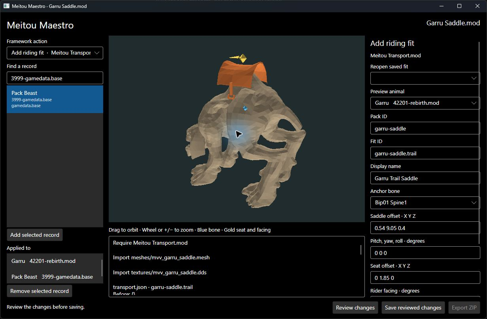
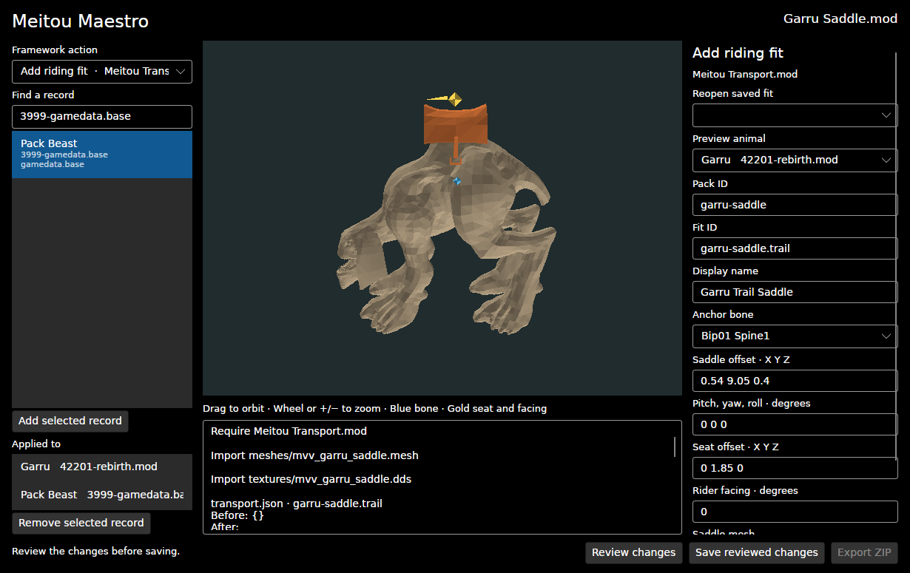
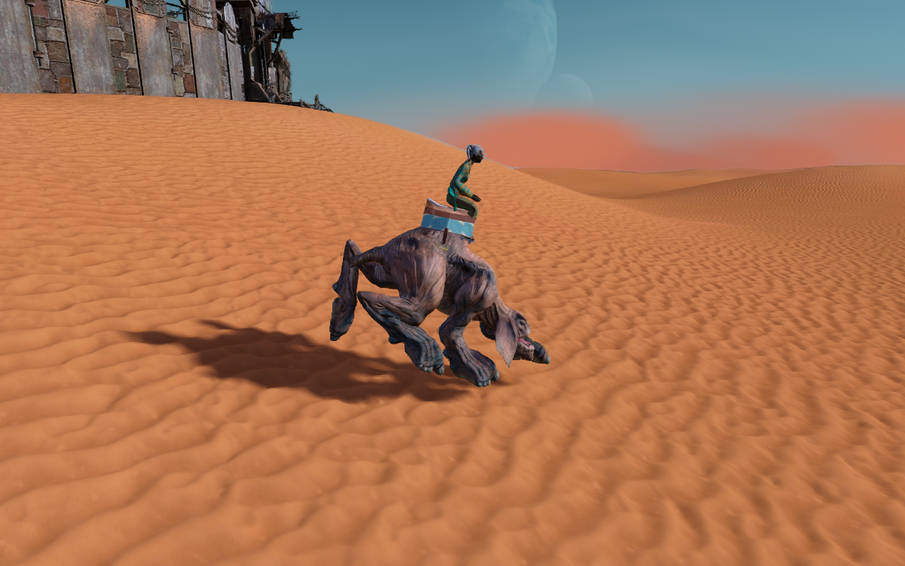
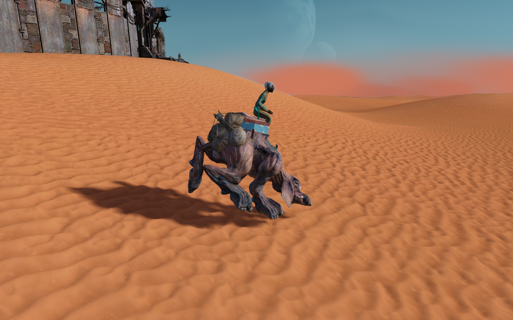

# Meitou v0.22.1 reader and authoring trial

Tested 2026-11-24. Candidate **Maestro 0.1.0-playtest.2**, .NET SDK 11.0.100, official MeitouClient **0.22.1+9ee4074bbc6fd7fdeb26108a04afc9f90cb1dc01**, and published **Transport v0.3.0-playtest.6**. The Windows game archive SHA-256 is `e9d1c41330d0859902b35db450209f86a5cf5093c846545153c3eb131161375f`.

The reader API required no changes to record discovery, mesh/skeleton decoding or editing operations. Both frontends now use the shared reader-version constant. Descriptor version 1 and Transport schema 3 remain unchanged. The existing public Maestro playtest.1 remains for v0.20.1; this candidate has not been released.

## Authoring on both platforms

The packaged Avalonia UI trial created an empty Garru Saddle project on Windows x64 and on Ubuntu 24.04.5 under WSLg, as an ordinary Linux user. Each selected Garru and Pack Beast, previewed both, applied the published Transport descriptor and reference fit, imported CC0 art, reviewed, saved, reopened and exported. The trial drives real controls; orbit and zoom were exercised in the visible viewport. Linux projects lived on the case-sensitive Linux filesystem.

| Editor | Renderer | Fitting frames | Orbit events | Zoom events |
| --- | --- | ---: | ---: | ---: |
| Windows x64 | ANGLE / NVIDIA RTX 3070 / D3D11 | 5 | 2 | 1 wheel |
| Ubuntu 24.04 under WSLg | Mesa llvmpipe, LLVM 20.1.2 | 12 | 8 | 1 wheel + 1 key |

The Linux test used software OpenGL, not native Linux GPU acceleration. A native Linux desktop remains an additional tester target. The same packaged executable on each platform discovered and reviewed the independently installed **Recognize worn goggles** action. This was an editor extensibility check; dialogue gameplay was not replayed in this pass.




## Export and ride proof

Both exports contain only the folder-wrapped `.mod`, `transport.json`, mesh and texture. The FCS dependency is solely `Meitou Transport.mod`. The FCS and art files are byte-identical across platforms and to the reference; JSON matches semantically, with only Windows/Linux newline differences between exports. The Linux ZIP was copied unchanged to Windows and all four installed files were checked against it.

| Export | ZIP SHA-256 |
| --- | --- |
| Windows | `482678d1868c4c3260a1d4751b8900c489a3cd2060425af752abcba41110601d` |
| Linux, before and after transfer | `780cdad8ebc7569a32348f73ba465dc7ee58a3b91797db98b3d303c3e80c59e2` |

Each isolated Windows game profile loaded **Meitou Transport -> Garru Saddle -> Stoat Desert Ride** from the published framework and start ZIPs plus its authored saddle. The client log confirmed one mount fit from that pack. The released Transport source supplied the observation driver. Errors below are full-run maxima, including save and remount, in world units.

| Authored pack / animal | Posed route frames | Turn frames | Heading change | Max saddle error | Max rider-pelvis error |
| --- | ---: | ---: | ---: | ---: | ---: |
| Windows / Garru | 120 | 41 | 92.2 degrees | 0.00873 | 0.01747 |
| Linux / Garru | 118 | 41 | 92.2 degrees | 0.00874 | 0.02344 |
| Linux / Pack Beast with stock bags | 119 | 41 | 92.2 degrees | 0.00873 | 0.01611 |

All runs passed the **under 0.08** attachment threshold, mounted movement, turn, save, reload, remount, dismount and ordinary on-foot movement. The bagged run observed bags on all 119 route frames; after camera removal and return it recorded eight consecutive aligned frames, one saddle, and intact bags and cargo. Different timing/frame counts are not evidence of different authored fits.




The broadside stills retain the original sample's blocky saddle and close contact with the Pack Beast's bags. This is attachment verification, not a claim of clipping-free art through every pose. No fit or art changes were made for this reader update.

## Regression and packaging checks

- Full solution build: zero warnings and errors, including the WPF reference frontend.
- Windows and Linux: reject old, missing and mixed readers; accept the current pair; retain the restart requirement for switching reader directories.
- Windows and Linux: reference and rotated transforms, portable filenames, missing/mis-cased assets; Linux additionally rejects case-alias files before export.
- Windows and Linux: custom project records, invalid bones, external-edit detection, interrupted-save rollback, asset replacement review, stable-ID updates, legacy placement preservation, invalid-provider isolation, and inherited dialogue overrides.
- Self-contained archives: 244 Windows files and 241 Linux files, with third-party notices, author guide and executable Linux apphost permissions; no Meitou game assemblies bundled.

Local editor archive SHA-256 values:

```text
4a9cc9e5d7539cb0978630339974b4493ad294f7a9d7835e624600e5a04f7a48  Meitou-Maestro-0.1.0-playtest.2-win-x64.zip
cc456e7cd0cf1ec6f5ad1eb4187d05174f6b087cd7c50e9f12b6249ef53cc770  Meitou-Maestro-0.1.0-playtest.2-linux-x64.tar.gz
```

Reproduction commands are in [TESTING.md](../TESTING.md). Earlier WPF results in [EVIDENCE.md](../EVIDENCE.md) remain historical v0.18.0 evidence. This pass did not rerun the boat voyage or publish a new release.
